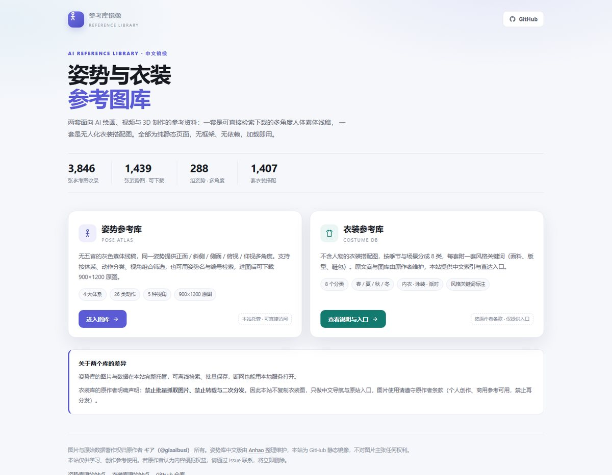
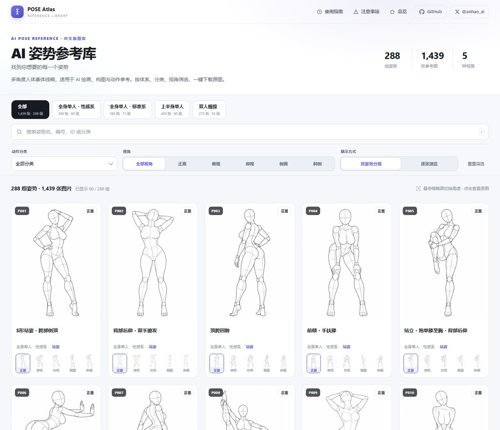

# AI 姿势与衣装参考库 · 中文镜像

> 1439 张多角度人体素体线稿 + 1407 套无人衣装图的中文导航。零依赖静态站，克隆即用，可直接部署到 GitHub Pages。

**在线地址：** <https://jasonbour.github.io/pose-costume-gallery-zh/>



| 板块 | 内容 | 状态 |
| --- | --- | --- |
| [姿势参考库](pose/) | 288 组姿势 / 1439 张 900×1200 参考图 / 4 体系 / 5 视角 | 图片完整托管，可检索、可下载 |
| [衣装参考库](costume/) | 1407 套无人衣装图 / 8 分类，中文说明与原站入口 | 仅中文索引页，**不托管图片** |



---

## 这是什么

两个原始站点都部署在境外免费托管上，链接在国内不方便直接发给别人，也无法离线保存。本仓库把它们整理成一个可以自己持有的静态站点：

1. **姿势库全量落地** —— 1439 条记录对应的缩略图（JPG 300×400）与 900×1200 原图全部下载，原图 PNG 统一转成 WebP，体积从 637 MB 压到 58 MB（约 1/11），画质肉眼看不出差别。
2. **页面本地化** —— 上游中文版单页画廊的域名、下载格式、仓库链接全部改写为本仓库地址，页脚保留原作者与中文版维护者署名。
3. **衣装库只做索引** —— 原作者明确禁止批量抓取与图片再分发，所以这里只放一页中文说明 + 原站入口，一张图都没有复制。
4. **一个入口页** —— 首页把两个库并列展示，说明差异与使用边界。

## 数据规模

### 姿势库

| 体系 | 条数 |
| --- | --- |
| 全身单人・标准系 | 365 |
| 全身单人・性感系 | 399 |
| 上半身单人 | 400 |
| 双人缠绵 | 275 |
| **合计** | **1439** |

每条记录对应 5 个视角中的若干个：正面 / 斜侧 / 侧面 / 俯视 / 仰视。

### 衣装库

| 分类 | 数量 | 分类 | 数量 |
| --- | --- | --- | --- |
| 春 | 215 | 内衣 | 199 |
| 夏 | 254 | 性感 | 140 |
| 秋 | 244 | 泳装 | 54 |
| 冬 | 253 | 派对 | 48 |
| | | **合计** | **1407** |

## 目录结构

```
.
├── index.html              # 总览页（两个库的入口）
├── pose/
│   ├── index.html          # 姿势画廊（单页，零依赖）
│   ├── index_src.html      # 上游原始单页（构建脚本的输入，留档备查）
│   ├── og-cover.jpg        # 分享封面 1200×630
│   ├── data/
│   │   ├── pose-zh.json    # 1439 条中文数据（前端实际读取）
│   │   └── meta-zh.json    # 体系分类
│   ├── thumbs/             # 缩略图 1439 张 JPG 300×400（26 MB）
│   └── img/                # 原图 1439 张 WebP 900×1200（58 MB）
├── costume/
│   └── index.html          # 衣装库中文说明页（无图片资源）
├── scripts/
│   ├── fetch_pose.py       # 并发下载器（断点续传 / 退避重试 / PNG→WebP）
│   ├── build_pose_page.py  # 把上游单页改成本站子页
│   ├── make_cover.py       # 生成 1200×630 分享封面
│   └── verify.py           # 校验素材完整性
├── docs/                   # README 预览图
├── assets/og-cover.jpg     # 总览页分享封面
├── .nojekyll               # 关闭 Jekyll，避免下划线路径被吞
├── robots.txt
├── sitemap.xml
├── LICENSE
└── README.md
```

## 页面功能

- 4 个体系页签，显示各体系的图片数与姿势组数
- 姿势名、编号、ID、分类关键词搜索，`/` 快速聚焦
- 动作分类、5 种视角组合筛选，一键重置
- **按姿势分组 / 逐张浏览**双模式，分组卡片带多角度缩略图
- 悬停或点击缩略图切换主图角度，点击卡片打开灯箱
- 灯箱先显示缩略图再加载原图，支持下载 WebP、复制 ID、新窗口打开
- `← / →` 切换角度，`↑ / ↓` 切换姿势，`Esc` 关闭；手机支持左右滑动
- PC 多列网格、手机双列网格，移动端筛选面板可展开收起

## 本地预览

页面通过 `fetch` 读取 JSON，需要 HTTP 环境（直接双击 `index.html` 会被 CORS 拦）：

```bash
python3 -m http.server 8000
# 打开 http://127.0.0.1:8000
```

## 部署到 GitHub Pages

仓库已是纯静态站点，无构建步骤、无框架、无依赖。

1. 推送代码到 GitHub 的 `main` 分支
2. 仓库 → **Settings** → **Pages**
3. **Source** 选 `Deploy from a branch`，分支 `main`，目录 `/ (root)`
4. 保存后 1–2 分钟，站点发布在 `https://<用户名>.github.io/<仓库名>/`

仓库根目录的 `.nojekyll` 必须保留：GitHub Pages 默认走 Jekyll，会忽略以下划线开头的文件与目录。

**限制参考：** 单文件 ≤ 100 MB、站点总量建议 ≤ 1 GB、每月流量 100 GB 软限制。当前仓库约 85 MB / 2895 个文件，远低于上限。

如果之后绑了自定义域名，需要同步替换 `index.html`、`pose/index.html`、`costume/index.html` 里的 `canonical`、`og:*`、`twitter:*`、JSON-LD，以及 `robots.txt`、`sitemap.xml` 中的绝对地址。

## 脚本用法

```bash
# 下载姿势库素材（已存在自动跳过，可反复执行；退避重试防限流）
WORKERS=6 python3 scripts/fetch_pose.py full    # 只补原图
WORKERS=6 python3 scripts/fetch_pose.py thumb   # 只补缩略图

# 重新生成 pose/index.html（改过域名或上游单页后执行）
python3 scripts/build_pose_page.py

# 校验文件完整性
python3 scripts/verify.py
```

上游对高频请求会直接返回 404（不是 429），并发建议不超过 8。脚本内置 1.2s × 重试次数的退避。

## 数据结构

`pose/data/pose-zh.json` 字段说明：

| 字段 | 原日文字段 | 示例 | 说明 |
| --- | --- | --- | --- |
| `id` | — | `full_sexy_P001_front` | 唯一标识 |
| `体系` | `系統` | 全身单人・性感系 | 4 大类 |
| `姿势编号` | `ポーズ番号` | `P001` | 80 组编号 |
| `分类` | `分類` | 站姿 | 26 类动作 |
| `姿势名称` | `ポーズ名` | S形站姿・胯部侧顶 | 288 种描述 |
| `角度` | `アングル` | 正面 | 5 种视角 |
| `缩略图` | `サムネ` | `thumbs/…jpg` | 相对路径 |
| `原图` | `原寸` | `img/…webp` | 相对路径（本仓库已转 WebP） |
| `检索` | — | 拼接串 | 供前端模糊搜索 |

## 内容提示

姿势库包含成人向姿势参考（部分分类名称涉及性行为术语），图片本身为无五官的灰色素体线稿，仅供艺术创作、动作参考与前端技术学习使用。请勿用于违法用途，未成年人请勿访问。

## 版权与致谢

- **图片与原始数据的著作权归原作者 ギア（[@giaaibusi](https://x.com/giaaibusi)）所有**
  - 姿势库原站：<https://ai-pose-gallery.pages.dev/>
  - 衣装库原站：<https://ai-costume-gallery.pages.dev/>
- 姿势库中文版由 [Anhao](https://x.com/anhao_ai) 整理维护，本仓库沿用其中文数据与前端，仅做托管与路径改造
- 衣装库原作者明确禁止批量抓取与图片再分发，本仓库**未收录任何衣装图片**，仅提供中文说明与原站入口
- 本仓库不对图片主张任何权利，也不构成对原作品的商业使用授权
- 若原作者认为本仓库侵犯其权益，请通过 Issue 联系，将立即删除相关内容
- `scripts/` 与页面代码以 MIT 协议开源（见 [LICENSE](LICENSE)），该协议**不覆盖** `pose/img/`、`pose/thumbs/`、`pose/data/` 中的图片与原始数据
